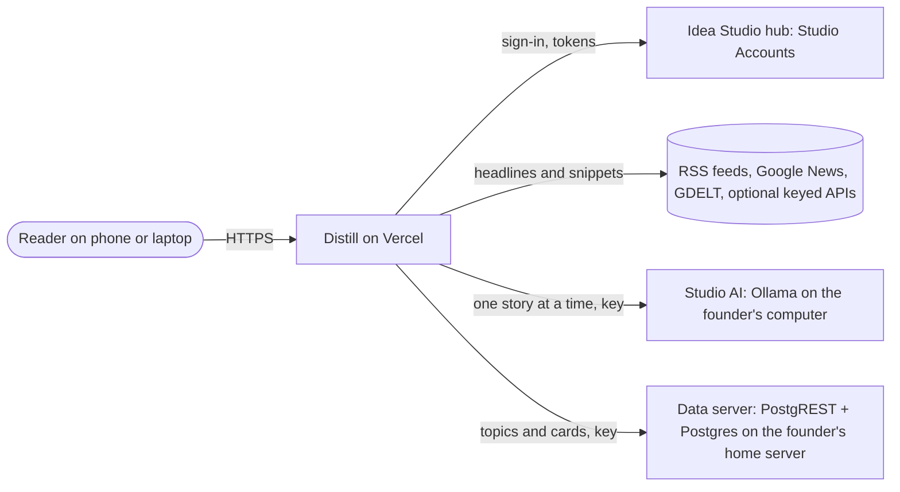
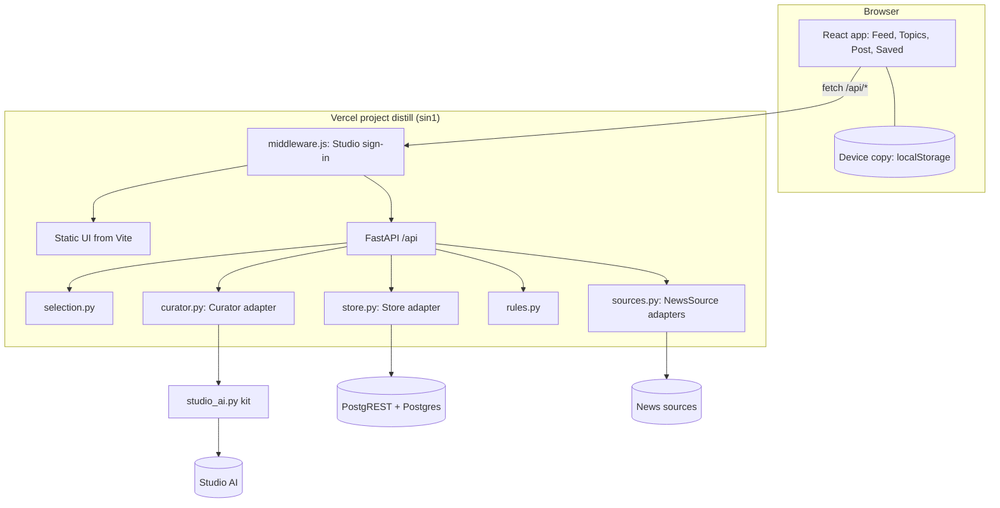

# Distill: Architecture

Last updated by CR-0001.

## Context

Who and what the system talks to.

## Components

| Component | Responsibility | Code |
|---|---|---|
| Interface | Screens, device copy, refresh progress, sync retries | `src/` |
| Sign-in | Studio Accounts redirect, session cookie, `/auth/me`, `/auth/logout` | `middleware.js` |
| API | Routes, errors in `{"error": {"code", "message"}}` | `backend/distill/app.py` |
| News sources | One adapter per source, all in parallel, 8-second limit, failures named | `backend/distill/sources.py`, `feeds.py` |
| Selection | Keyword filter, duplicates, 15-story cap, sections take turns | `backend/distill/selection.py` |
| Curator | Studio AI prompt with JSON schema; validates, trims and checks numbers | `backend/distill/curator.py`, `prompts.py` |
| Rules | 24-hour expiry, same-story replacement, sync merge | `backend/distill/rules.py` |
| Store | Per-person state in Postgres through PostgREST | `backend/distill/store.py`, `data-server/` |

## Data model
One document per person (`UserState`), kept on the device and, when sync is set up, in `api.user_state (user_id text primary key, state jsonb, updated_at timestamptz)`:

| Part | Fields |
|---|---|
| `topics` | sections, keywords, updated_at |
| `cards[]` | id, topic_section (a section id or `kw:<keyword>`), title, source_name, source_url, published_at, fetched_at, summary (≤ 400), key_points (2 to 4), key_figures [{label, value, unit}], story_key, relevance, saved, saved_changed_at, ai_status |
| `settings` | last_refreshed_at, theme |

A single JSON row per person keeps the data server to one table and makes sync one read and one upsert; the volume is tiny (tens of cards per person).

## Integrations and adapters
External services sit behind adapters so they can be mocked in tests and demos and swapped for real ones later.

| Integration | Adapter | Current mode | To go live |
|---|---|---|---|
| Publisher RSS, Google News, GDELT | `NewsSource` (`RssFeed`, `Gdelt`) | Live, no key | Nothing |
| The Guardian, NewsData.io, Currents, Marketaux | `NewsSource` (`Guardian`, `NewsData`, `Currents`, `Marketaux`) | Off until a key is set | Founder adds `GUARDIAN_API_KEY`, `NEWSDATA_API_KEY`, `CURRENTS_API_KEY`, `MARKETAUX_API_KEY` in Vercel |
| Studio AI | `Curator` (`StudioAICurator`) | Live when `AI_ENDPOINTS` and `AI_GATEWAY_KEY` are linked; otherwise headline-only cards | Link the shared AI variables to the project |
| Data server | `Store` (`PostgrestStore`) | Off until set; everything stays on the device | Founder runs `data-server/` and adds `DATA_ENDPOINT`, `DATA_GATEWAY_KEY` |
| Studio Accounts | `middleware.js`, `studio_auth.py` | Live | Founder adds Distill's live address in hub admin and turns sign-in on |

## Key flows
1. **Refresh:** the app sends its topics and known links to `POST /api/feed/refresh` → all sources at once → keyword filter, duplicates, cap → up to 15 stories. The app then calls `POST /api/feed/curate` for each ("Summarising 3 of 12"), merges the new cards with `POST /api/feed/merge`, saves the device copy and syncs.
2. **Open the app:** the device copy shows at once (expired cards dropped); then `PUT /api/me/state` sends it and takes back the combined copy. Without sync, `/api/feed/merge` applies the full rules.
3. **Save while the data server is off:** the change stays on the device, marked pending; the toast says "Saved on this device, will sync later"; the next request that reaches the data server sends it.

## Quality attributes
- **Performance:** one JS bundle of about 54 kB gzipped plus two serif font files; charts are inline SVG. Each AI call is its own short request.
- **Security:** keys only on the server (Vercel variables); the data server only accepts requests with its key, publishes nothing but Caddy on 127.0.0.1, and PostgREST can only touch one table. Outbound links use `rel="noopener noreferrer"`. AI output is validated before it is shown.
- **Privacy:** only the Studio Accounts user id, topics and cards are stored; never full articles, emails or names.
- **Accessibility:** labelled controls, visible focus, 44px targets, AA contrast in both themes, charts carry a text version as their accessible name, motion respects `prefers-reduced-motion`.
- Verified by the acceptance tests ([TEST-REPORT](../quality/TEST-REPORT.md)) and the visual check.

## Decisions
See [../adr/](../adr/). The most important so far:
- [ADR-0001](../adr/0001-spec-driven-development.md): spec-driven development.
- [ADR-0002](../adr/0002-stack.md): tier R, React + FastAPI on Vercel, inline SVG charts.
- [ADR-0003](../adr/0003-sync-through-home-data-server.md): sync through a data server on the founder's home server, device copy first.
