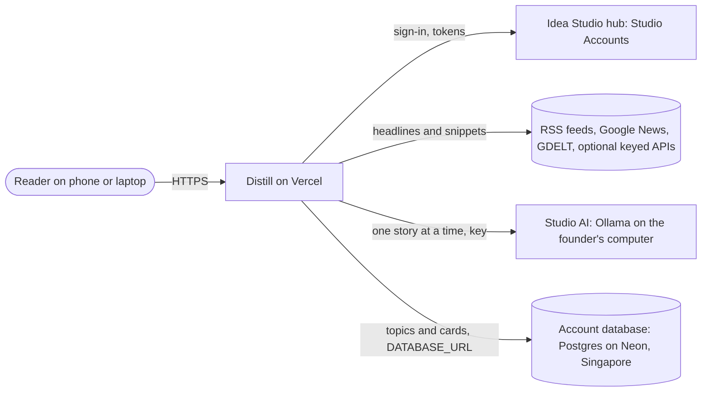
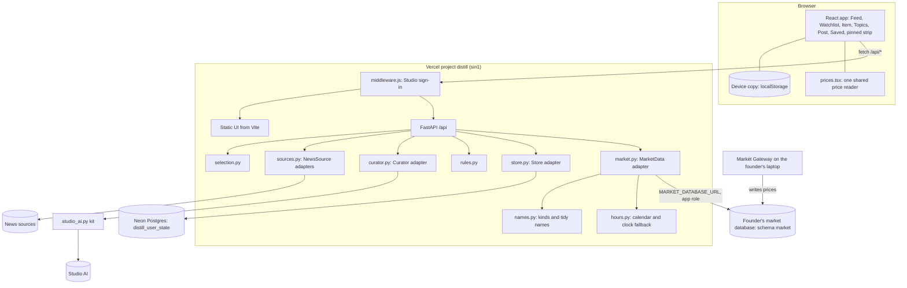

# Distill: Architecture

Last updated by CR-0006.

## Context

Who and what the system talks to.

## Components

| Component | Responsibility | Code |
|---|---|---|
| Interface | Screens, device copy, refresh progress, sync retries | `src/` |
| Sign-in | Studio Accounts redirect, session cookie, `/auth/me`, `/auth/logout` | `middleware.js` |
| API | Routes, errors in `{"error": {"code", "message"}}` | `backend/distill/app.py` |
| News sources | One adapter per source, all in parallel, 8-second limit, failures named | `backend/distill/sources.py`, `feeds.py` |
| Selection | Keyword filter, duplicates, 15-story cap, sections take turns | `backend/distill/selection.py` |
| Curator | Studio AI prompt with JSON schema; validates, trims and checks numbers | `backend/distill/curator.py`, `prompts.py` |
| Rules | 24-hour expiry, same-story replacement, sync merge | `backend/distill/rules.py` |
| Store | Per-person state in the account database (Postgres on Neon, `psycopg`), one transaction per sync | `backend/distill/store.py` |
| Market data | Search (by group, gold kinds kept apart), watch and prices from the shared market database in one connection per read; labels, the paused rule and Zerodha prices for the founder only (CR-0005); kinds and tidy names, and the market calendar with a clock fallback, reading the gateway's optional `category` and `market_calendar` when they exist (CR-0006, [ADR-0006](../adr/0006-watchlist-v2-and-calendar-fallback.md)) | `backend/distill/market.py`, `names.py`, `hours.py` |
| Watchlist interface | Shared price reader (reads only while the strip, the Watchlist or an item is on screen), pinned strip, Watchlist page with Edit mode, Add sheet, item detail, calm-state rules and the watchlist migration (CR-0006) | `src/prices.tsx`, `src/watch.ts`, `src/markets.ts`, `src/components/Strip.tsx`, `src/components/AddSheet.tsx`, `src/screens/Watchlist.tsx`, `src/screens/Item.tsx` |

## Data model
One document per person (`UserState`), kept on the device and, when the account database is set up, in `distill_user_state (user_id text primary key, state jsonb, updated_at timestamptz)`, created automatically when missing:

| Part | Fields |
|---|---|
| `topics` | sections, keywords, updated_at |
| `cards[]` | id, topic_section (a section id or `kw:<keyword>`), title, source_name, source_url, published_at, fetched_at, summary (≤ 400), key_points (2 to 4), key_figures [{label, value, unit}], story_key, relevance, saved, saved_changed_at, ai_status, replaced_at (optional; when a newer report replaced an older card, added CR-0004) |
| `settings` | last_refreshed_at, theme |
| `watchlist` | keys (the first 10 market keys in display order), more (items 11 to 20), pinned (up to 6, strip order), strip (`every`, `feed`, `off`), version (2), updated_at; absent in copies saved before v0.4.0, read as empty (added CR-0005). Version 1 copies (v0.4.0: keys only) are upgraded on load: first 6 pinned, strip on every screen; a newer change from a v0.4.0 device keeps the stored more, pinned and strip (CR-0006) |

The device also keeps `distill.seen.v1` in browser storage: the links the AI has already judged on that device, with when, for 36 hours (at most 500). It is never synced and only feeds `known_urls`, so stories already judged are not sent to the AI again (CR-0004).

A single JSON row per person keeps the database to one table and makes sync one read and one upsert; the volume is tiny (tens of cards per person).

## Integrations and adapters
External services sit behind adapters so they can be mocked in tests and demos and swapped for real ones later.

| Integration | Adapter | Current mode | To go live |
|---|---|---|---|
| Publisher RSS, Google News, GDELT | `NewsSource` (`RssFeed`, `Gdelt`) | Live, no key | Nothing |
| The Guardian, NewsData.io, Currents, Marketaux | `NewsSource` (`Guardian`, `NewsData`, `Currents`, `Marketaux`) | Off until a key is set | Founder adds `GUARDIAN_API_KEY`, `NEWSDATA_API_KEY`, `CURRENTS_API_KEY`, `MARKETAUX_API_KEY` in Vercel |
| Studio AI | `Curator` (`StudioAICurator`) | Live when `AI_ENDPOINTS` and `AI_GATEWAY_KEY` are linked; otherwise headline-only cards | Link the shared AI variables to the project |
| Account database (Neon) | `Store` (`PostgresStore`; `MemoryStore` in tests) | Live in Production when `DATABASE_URL` is set; previews and local runs stay device-only | Done: the founder connected Neon to the project (Production) |
| Market prices (Market Gateway via a shared Neon database) | `MarketData` (`PostgresMarket`; `FakeMarket` in tests) | Off until `MARKET_DATABASE_URL` is set: the Watchlist says "Price source not set up yet" and the strip stays hidden. Reads the gateway's `category` and `market_calendar` (Market Gateway E1) when they exist | Founder runs the Market Gateway and adds `MARKET_DATABASE_URL` (the contract's `app` role) in Vercel, Production |
| Studio Accounts | `middleware.js`, `studio_auth.py` | Live | Founder adds Distill's live address in hub admin and turns sign-in on |

## Key flows
1. **Refresh:** the app sends its topics and known links to `POST /api/feed/refresh` → all sources at once → keyword filter, duplicates, cap → up to 15 stories. The app then calls `POST /api/feed/curate` for each ("Summarising 3 of 12"), merges the new cards with `POST /api/feed/merge`, saves the device copy and syncs.
2. **Open the app:** the device copy shows at once (expired cards dropped); then `PUT /api/me/state` sends it and takes back the combined copy. Without sync, `/api/feed/merge` applies the full rules.
3. **Save while the database can't be reached:** the change stays on the device, marked pending; the toast says "Saved on this device, will sync later"; the next request that reaches the database sends it.
4. **Sync:** `PUT /api/me/state` opens a short connection, locks the person's row, merges the stored copy with the device's (`rules.merge_states`) and saves it in the same transaction.
6. **Prices on screen (CR-0006):** the shell decides whether prices are on screen (the strip is shown by its setting, or the Watchlist or an item is open); only then does `prices.tsx` tell the gateway the keys are wanted (`POST /api/market/watch`) and read `GET /api/market/prices` for all watched items, every 30 s while a watched market is open (by the `markets` map in the answer), every 15 minutes otherwise, never while the page is hidden. The answer's `markets` come from `market.market_calendar` when its row fits the current time, otherwise from Distill's own hours; `watch.ts` turns them and the gateway's paused flag into the calm notes.
5. **Fresh feed (CR-0004):** while the Feed is open and the page is visible, it checks every 30 seconds whether 15 minutes have passed since the last refresh (or the last automatic try), and also checks when the page becomes visible again or gets focus; nothing runs in the background. When cards that weren't on screen arrive while the reader is more than 120 px down the page, the Feed keeps showing what was on screen and shows a "N new" pill; tapping it (or scrolling back to the top) shows the new cards.

## Quality attributes
- **Performance:** one JS bundle of about 54 kB gzipped plus two serif font files; charts are inline SVG. Each AI call is its own short request.
- **Security:** keys only on the server (Vercel variables); the database address lives only in the Vercel variable `DATABASE_URL` (Production), connections use TLS, and queries are parameterised. Outbound links use `rel="noopener noreferrer"`. AI output is validated before it is shown.
- **Privacy:** only the Studio Accounts user id, topics and cards are stored; never full articles, emails or names.
- **Accessibility:** labelled controls, visible focus, 44px targets, AA contrast in both themes, charts carry a text version as their accessible name, motion respects `prefers-reduced-motion`.
- Verified by the acceptance tests ([TEST-REPORT](../quality/TEST-REPORT.md)) and the visual check.

## Decisions
See [../adr/](../adr/). The most important so far:
- [ADR-0001](../adr/0001-spec-driven-development.md): spec-driven development.
- [ADR-0002](../adr/0002-stack.md): tier R, React + FastAPI on Vercel, inline SVG charts.
- [ADR-0003](../adr/0003-sync-through-home-data-server.md): device copy first and the sync merge rules (its storage part is superseded).
- [ADR-0004](../adr/0004-account-database-on-neon.md): the account database is hosted Postgres on Neon.
- [ADR-0005](../adr/0005-market-data-from-shared-database.md): prices from the founder's shared market database.
- [ADR-0006](../adr/0006-watchlist-v2-and-calendar-fallback.md): watchlist version 2 and the gateway's optional calendar and categories with Distill's own fallback.
